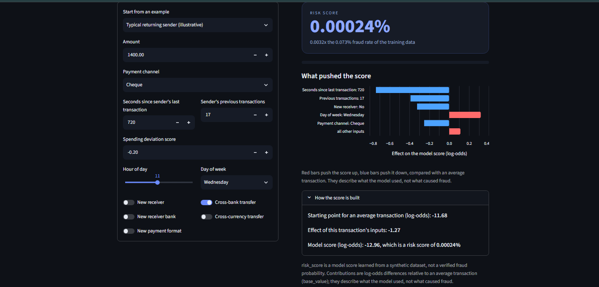
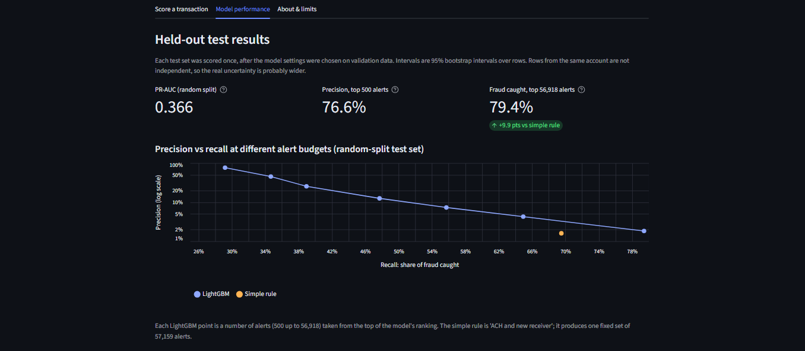
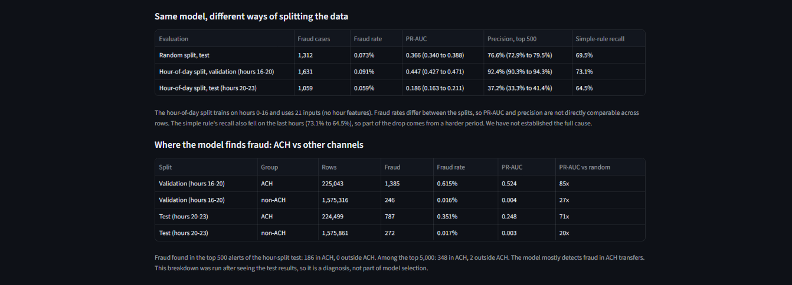
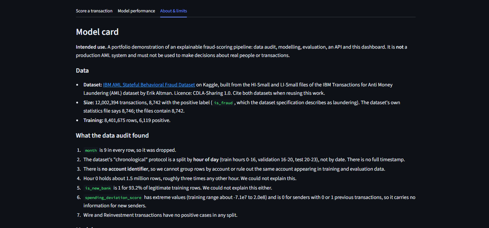
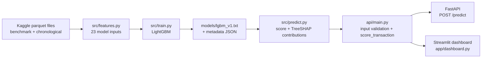
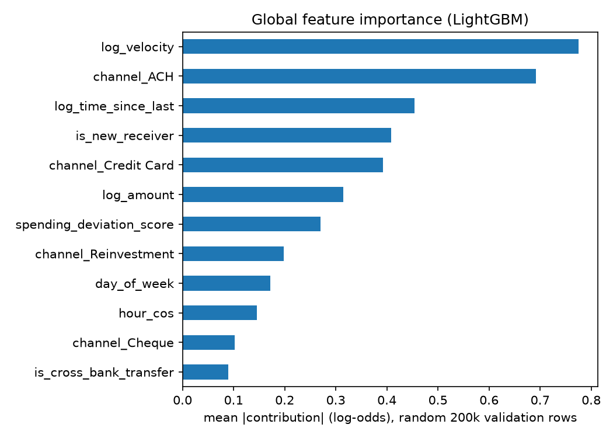

# AML Fraud Scoring

> Explainable fraud-risk scoring for bank transfers: data audit → LightGBM model → validated FastAPI service → Streamlit dashboard, evaluated honestly on 12 million synthetic transactions.


**[🔗 Live demo](https://aml-fraud-detection-ksi9fgenkx7va3x4mfkopn.streamlit.app/)** · [Results](#results) · [API](#api) · [Quick start](#quick-start) · [Limitations](#limitations)

<!-- TODO: replace the live demo URL above after deploying to Streamlit Community Cloud -->



---

## Highlights

- **Large-scale, highly imbalanced data:** 12,002,394 transactions with about 0.07% positive labels. The model trains on 8.4M rows (6,119 positives).
- **Evaluated the way an analyst team would use it:** PR-AUC plus precision and recall at fixed *alert budgets* (top 500, 1,000 … 56,918 alerts), not accuracy.
- **Beats a simple rule at the same workload:** with about the same number of alerts as the rule "ACH + new receiver" (56,918 vs 57,159), the model catches **79.4%** of fraud on the random-split test set versus **69.5%** for the rule.
- **Two evaluation protocols, reported side by side:** a random split (PR-AUC 0.366) and an hour-of-day split (PR-AUC 0.186 on the last hours). The drop is shown, not hidden.
- **Explainable per transaction:** every score comes with feature contributions (LightGBM's built-in TreeSHAP) that add up exactly to the model's log-odds score.
- **Defensive API:** inputs are range-checked against the training data, and impossible combinations (for example, a "first transaction" that is not to a new receiver) are rejected.
- **Honest model card:** a dedicated limitations section, with caveats about synthetic data, a possible account-overlap problem, and unexplained findings from the data audit.

---

## Results

All test sets were scored **once**, after model settings were chosen on validation data. Intervals are 95% Poisson-bootstrap intervals over rows. Rows from the same account are not independent, so the real uncertainty is probably wider.

### Same model, different ways of splitting the data

| Evaluation | Fraud cases | Fraud rate | PR-AUC (95% interval) | Precision, top 500 alerts |
|---|---:|---:|---|---|
| Random split, test | 1,312 | 0.073% | **0.366** (0.340 – 0.388) | **76.6%** (72.9 – 79.5%) |
| Hour-of-day split, validation (hours 16–20) | 1,631 | 0.091% | 0.447 (0.427 – 0.471) | 92.4% (90.3 – 94.3%) |
| Hour-of-day split, test (hours 20–23) | 1,059 | 0.059% | 0.186 (0.163 – 0.211) | 37.2% (33.3 – 41.4%) |

A random scorer would get a PR-AUC equal to the fraud rate (about 0.0006–0.0009).

The hour-split result is lower on the last hours. Part of that is a harder period: the fraud rate is lower, and the simple rule's recall also fell (73.1% → 64.5%). The full cause is **not established**, and fraud rates differ between splits, so the rows are not directly comparable.

### Alert budgets (random-split test set)

| Alerts reviewed | Precision | Recall |
|---:|---:|---:|
| 500 | 76.6% | 29.2% |
| 1,000 | 45.5% | 34.7% |
| 2,000 | 25.6% | 39.0% |
| 5,000 | 12.5% | 47.7% |
| 10,000 | 7.3% | 55.7% |
| 20,000 | 4.3% | 64.9% |
| 56,918 | 1.8% | **79.4%** |
| *Simple rule: ACH + new receiver (57,159 alerts)* | *1.6%* | *69.5%* |

56,918 is the number of alerts the simple rule produces on the validation split, so that row compares the model and the rule at roughly equal workload.

### Where the model finds fraud

The model mostly detects fraud in **ACH** transfers. About 81% of training positives are ACH, and in the hour-split test the top 500 alerts contain 186 confirmed cases in ACH and 0 outside it (348 vs 2 in the top 5,000). Wire and Reinvestment transactions have no positive cases in any split. This breakdown was run *after* seeing the test results, so it is a diagnosis, not part of model selection.





---

## Dashboard

The Streamlit app has three tabs:

1. **Score a transaction:** enter a transaction (or start from a preset), see the risk score, how many times the training fraud rate it represents, and a bar chart of what pushed the score up or down.
2. **Model performance:** held-out test metrics, precision-recall by alert budget versus the simple rule, split comparison, ACH breakdown, feature importance and the hyperparameter search.
3. **About & limits:** model card, data audit findings and limitations.



---

## Architecture



The dashboard and the API share the same validation and scoring code, so what you see in the app is exactly what the API returns.

---

## Data

- **Dataset:** [IBM AML Stateful Behavioral Fraud Dataset](https://www.kaggle.com/datasets/vai136/ibm-aml-stateful-behavioral-fraud-dataset) on Kaggle, built from the HI-Small and LI-Small files of the IBM *Transactions for Anti Money Laundering (AML)* dataset. Licence: CDLA-Sharing 1.0.
- **Size:** 12,002,394 transactions. The positive label `is_fraud` (described by the dataset specification as laundering) appears in **8,742** rows; the dataset's own statistics file says 8,746, but the files contain 8,742.
- **Behavioural inputs come ready-made.** Columns such as `velocity_score` (number of previous transactions by the sender) and `spending_deviation_score` are provided by the dataset, so the API expects them as inputs. This project does not compute account history.
- **Synthetic data.** Everything comes from a simulator. Results should not be read as performance on a real bank.

### What the data audit found

Full code in [`notebooks/01_data_audit_eda.ipynb`](notebooks/01_data_audit_eda.ipynb).

1. `month` is 9 in every row, so it was dropped.
2. The dataset's "chronological" protocol is a split by **hour of day** (train hours 0–16, validation 16–20, test 20–23), not by date. There is no full timestamp.
3. There is **no account identifier**, so rows cannot be grouped by account, and the same account may appear in training and evaluation data.
4. Hour 0 holds about 1.5 million rows, roughly three times any other hour. This could not be explained.
5. `is_new_bank` is 1 for 93.2% of legitimate training rows. This could not be explained either.
6. `spending_deviation_score` has extreme values (training range about −7.1e7 to 2.0e8) and is 0 for senders with 0 or 1 previous transactions, so it carries no information for new senders.
7. Derived flags are fully consistent with their sources: `is_weekend` matches `day_of_week >= 5` and `is_first_transaction` matches `velocity_score == 0` in 100% of validation rows, and every first transaction is also a new receiver, new bank and new payment format. The API validation encodes these rules.
8. Wire and Reinvestment transactions have no positive cases in any split.

---

## Modelling

**Inputs (23).** Log-transformed amount, time since last transaction and previous-transaction count; spending deviation score; `burst` (zero gap to the previous transaction for a known sender); `has_history` (at least 2 previous transactions); hour encoded as sine/cosine; day of week; seven binary flags (first transaction, weekend, cross-bank, cross-currency, new receiver, new bank, new payment format); and a one-hot payment channel. The hour-split model uses 21 inputs (no hour features), since hours define its splits.

**Model.** LightGBM classifier (1,500 trees, learning rate 0.05, 15 leaves, `min_child_samples` 500, L2 regularisation 10, 0.8 row and column subsampling, seed 42), trained on the random (benchmark) split. No resampling or class weighting; the ranking is evaluated with PR-AUC and alert budgets.

**Hyperparameter search.** Five configurations were compared on validation data (learning rate 0.1 for speed). Validation PR-AUC ranged only from 0.405 to 0.409, which is probably within sampling noise, so the original settings were kept.

**Explainability.** Each score comes with per-input contributions from LightGBM's `pred_contrib` (TreeSHAP). Contributions are grouped by original input (for example, all payment-channel columns become one "payment channel" factor), and `base_value + contributions + other` equals the raw log-odds score (checked in the notebook and in a unit test). They describe what the model used, not what *caused* fraud.

**Calibration check.** On random-split validation data, score bands matched observed fraud rates closely, but the score is intended for **ranking**, not as a verified probability.



The most influential inputs are the sender's previous-transaction count, the ACH channel, time since the last transaction and whether the receiver is new. Because the dataset has no account identifier, the previous-transaction count may partly act as an account fingerprint shared between training and evaluation rows.

---

## API

Start the server (see [Quick start](#quick-start)) and open the interactive docs at `http://127.0.0.1:8000/docs`.

| Endpoint | Description |
|---|---|
| `GET /health` | Model file, training timestamp and number of features |
| `POST /predict` | Score one transaction |

**Example request**

```bash
curl -X POST http://127.0.0.1:8000/predict \
  -H "Content-Type: application/json" \
  -d '{
    "amount": 11139.43,
    "payment_channel": "ACH",
    "time_since_last_transaction": 0,
    "velocity_score": 61,
    "spending_deviation_score": 0.5,
    "hour": 14,
    "day_of_week": 2,
    "is_cross_bank_transfer": 1,
    "is_cross_currency_transfer": 0,
    "is_new_receiver": 1,
    "is_new_bank": 1,
    "is_new_payment_format": 0
  }'
```

**Response fields**

| Field | Meaning |
|---|---|
| `risk_score` | Model score between 0 and 1 (use it to rank transactions) |
| `times_train_base_rate` | The score divided by the fraud rate of the training data |
| `base_value` | Starting point (log-odds) for an average transaction |
| `top_factors` | Top 5 inputs with their value and contribution (log-odds) |
| `other_contribution` | Combined contribution of all remaining inputs |
| `warnings` | Inputs outside the range of 99.8% of training rows |
| `note` | Reminder that this is a model score, not a verified fraud probability |

**Validation.** Values outside the training range are rejected. Values outside the 0.1%–99.9% range are scored with a warning. Impossible combinations are rejected, for example `velocity_score = 0` (a first transaction) with `is_new_receiver = 0`, or a non-zero `spending_deviation_score` when the sender has 0 or 1 previous transactions.

---

## Quick start

Tested with Python 3.12.

```bash
git clone https://github.com/mariasamaan121212/aml-fraud-detection.git
cd aml-fraud-detection

python -m venv .venv
# Windows:        .venv\Scripts\activate
# macOS / Linux:  source .venv/bin/activate

pip install -r requirements.txt
```

**Run the dashboard** (the trained model in `models/` is included, no dataset needed):

```bash
streamlit run app/dashboard.py
```

**Run the API:**

```bash
uvicorn api.main:app --reload
```

**Retrain and re-evaluate** (needs the dataset):

1. Download the dataset from [Kaggle](https://www.kaggle.com/datasets/vai136/ibm-aml-stateful-behavioral-fraud-dataset). It is about 12M rows, so it is not stored in this repository.
2. Place the parquet files like this:

   ```text
   data/raw/benchmark/{train,valid,test}.parquet
   data/raw/chronological/{train,valid,test}.parquet
   ```

3. Train, then run the notebook to reproduce the evaluation reports:

   ```bash
   pip install -r requirements-dev.txt
   python -m src.train
   ```

**Run the tests** (15 tests covering feature engineering, API validation and the contribution identity):

```bash
pytest
```

---

## Project structure

```text
aml-fraud-detection/
├── api/
│   └── main.py              # FastAPI app, input validation, score_transaction
├── app/
│   └── dashboard.py         # Streamlit dashboard (3 tabs)
├── src/
│   ├── data.py              # parquet loading
│   ├── features.py          # 23 model inputs
│   ├── train.py             # LightGBM training + metadata
│   ├── predict.py           # scoring + grouped TreeSHAP contributions
│   ├── evaluate.py          # alert-budget table, Poisson bootstrap
│   └── limits.py            # training-range limits used by the API
├── notebooks/
│   └── 01_data_audit_eda.ipynb
├── models/                  # lgbm_v1.txt + lgbm_v1_meta.json
├── reports/                 # result JSON files, tuning CSV, feature importance
├── tests/                   # test_api.py, test_features.py
├── docs/images/             # README screenshots
├── data/raw/                # dataset goes here (not in the repo)
├── requirements.txt
└── requirements-dev.txt
```

---

## Limitations

- **Not a production AML system.** This is a portfolio demonstration and must not be used to make decisions about real people or transactions.
- **Synthetic data.** Results come from a simulator.
- **Mostly ACH.** The model finds fraud almost only in ACH transfers (348 of 350 confirmed cases in the top 5,000 alerts of the hour-split test).
- **Possible account overlap.** There is no account identifier, so the random split can put the same account in both training and evaluation data, which may inflate those results. The hour split does not separate accounts either.
- **Harder late hours.** PR-AUC was 0.447 on hours 16–20 and 0.186 on hours 20–23. Part of this is a lower fraud rate and a harder period; the full cause is not established.
- **Few positive cases.** The test sets hold 1,312 and 1,059 positives, so results move by a few points between samples.
- **Scores, not probabilities.** Use the score to rank transactions and to choose how many alerts a team can review.
- **Optimistic validation numbers.** Model settings were chosen on validation data. The test sets were scored once, but the ACH breakdown was run after seeing test results.

## Possible next steps

- Group-aware evaluation, if a dataset with an account identifier becomes available.
- Probability calibration (for example isotonic regression) for the late-hours setting.
- Compare other model families under the same alert-budget metrics.
- Containerise the API (Docker) and deploy it separately from the dashboard.

---

## License and citation

Code: MIT License (see `LICENSE`).

The dataset is licensed under CDLA-Sharing 1.0. If you reuse this work, please cite both:

1. The original IBM *Transactions for Anti Money Laundering (AML)* dataset: Altman et al., *Realistic Synthetic Financial Transactions for Anti-Money Laundering Models*, NeurIPS 2023.
2. The [IBM AML Stateful Behavioral Fraud Dataset](https://www.kaggle.com/datasets/vai136/ibm-aml-stateful-behavioral-fraud-dataset) on Kaggle.

## Author

**Maria Samaan**: data and machine learning

[LinkedIn](https://www.linkedin.com/in/maria-samaan-cs) · [GitHub](https://github.com/mariasamaan121212)

<!-- TODO: add Fiverr / Upwork link here once the profile exists -->
